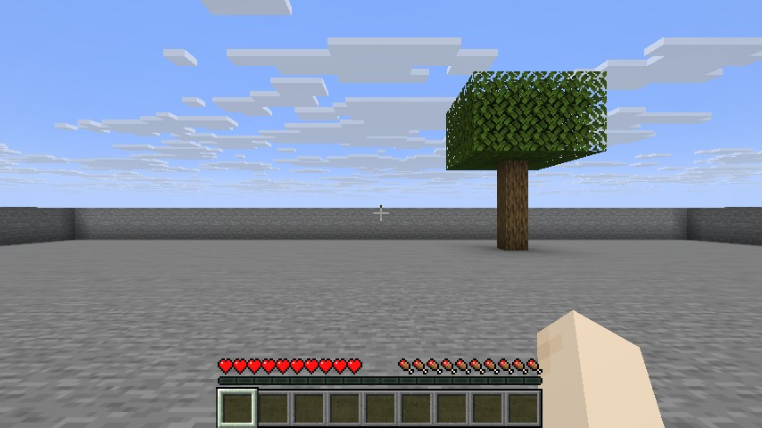

# vla-marionette-demo

This demo shows how [vla-marionette](https://github.com/Azetus/vla-marionette) connects a model to a real Minecraft Java client. The mod streams the player's view to the model and applies its keyboard and mouse actions in the game.

The demo uses [ROCKET-3-1.5x](https://huggingface.co/CraftJarvis/ROCKET-3-1.5x), a pretrained Minecraft policy developed by the CraftJarvis research team. Watch it approach the oak tree on the right and mine one marked log. The host builds the single-tree scene, switches from Approach to Mine within three horizontal blocks of the trunk center and checks which block disappeared.



## Run on Windows

1. Start **Minecraft Java 26.1.2 + NeoForge 26.1.2.126** once. Prepare a creative or survival single-player **superflat Overworld** save with commands enabled; close the world before starting the demo. The script uses its own copy. The tested launcher layout has a self-contained version JSON, matching client JAR, extracted natives, libraries and assets. Java 25, PowerShell 7, uv and a CUDA 13 compatible NVIDIA driver with BF16 support are required. The tested card is an RTX 5060 Ti 16 GB.
2. Open PowerShell 7 in the project directory. Create your local configuration once:

   ```powershell
   Copy-Item config.example.json config.local.json
   ```

   Replace all three placeholders in `config.local.json` with absolute paths. Use forward slashes in JSON paths, or double each backslash.

   | Field | What to select |
   |---|---|
   | `minecraftVersionDir` | The installed NeoForge **version directory** containing its matching version JSON and client JAR. |
   | `worldSource` | The closed test world's directory containing `level.dat`. Keep the source save outside this repository. |
   | `java` | The Java 25 executable (`bin/java.exe`). |

   For custom client layouts, optional fields `assetsDir`, `librariesDir` and `nativesDir` override the detected locations.

3. Start each spectator run with:

   ```powershell
   .\demo.ps1
   ```


The PowerShell entry point uses uv to provision the Python host and inference worker. The first invocation installs a private Python 3.12 CUDA environment, downloads the pinned [ROCKET-3 checkpoint](https://huggingface.co/CraftJarvis/ROCKET-3-1.5x), [official PyTorch loader](https://github.com/CraftJarvis/ROCKET-3) and [bridge JAR](https://github.com/Azetus/vla-marionette/releases/tag/v0.1.1), and verifies their SHA-256 hashes. Later runs reuse the local cache. Optional JSON fields `checkpoint` and `modJar` accept already downloaded copies. The single-player launcher uses local installed game files. Reserve several GB for first-time setup.

Git ignores the machine-specific configuration (`config.local.json`), Python environment (`.venv/`), downloaded files (`.cache/`) and per-run directories (`runs/`), including copied saves, launch arguments and logs. The three files under `assets/` are the shared reference image and target masks.

The game window opens automatically. Let the host set up the scene and load the model. Keep the game window open; you can observe without moving the character. When the demo ends, controls are released and the window stays open for inspection. Close it before the next run if you want to reclaim GPU memory. A timeout or the removal of a different log counts as a failed trial.

## How input reaches the game

Each client tick supplies a fresh JPEG. The policy takes the current RGB, a fixed reference captured at the start, a binary target mask and interaction ID (6 for Approach, 2 for Mine). The worker carries recurrent state and the action applied at the observation tick. MineStudio decodes the sampled buttons and camera; [the host mapping](host/scene.py) resolves live key bindings and converts pitch/yaw degrees into calibrated mouse deltas. Each ActionChunk covers one tick. The host checks received, applied and ended receipts, and releases input at the stage boundary and on exit. World state is used for setup, switching stages and evaluation.

Each invocation writes to its own `runs/<timestamp>/`. See `goal.jpg`, `arrival.jpg`, `final.jpg`, `result.json`, `summary.json` and `run.jsonl` for screenshots, the task result, warm performance and the action receipts. Success requires the designated log at (-6, 101, 14) to become air while the other three right-tree logs remain. Item pickup is a separate outcome. Model sampling and tick timing can produce different results across runs.

